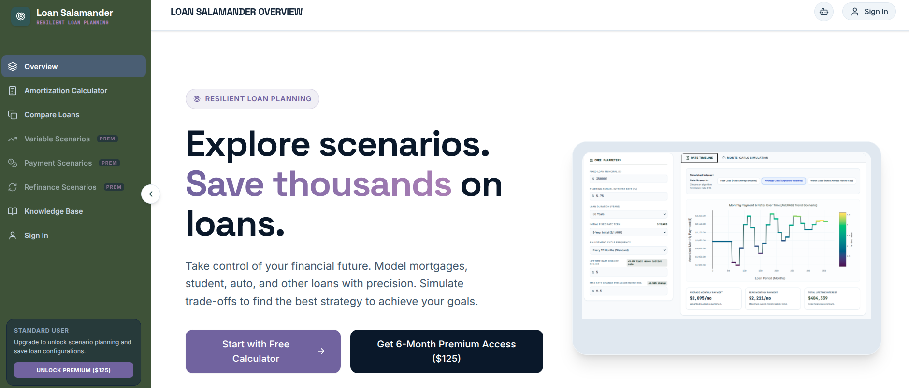

# Loan Salamander

The self-hosted version of [Loan Salamander](https://www.loansalamander.com/): an application for loan planning with tools for analysis, comparison, and scenario modeling. All data is stored locally in SQLite—no external services required.



## Quick Start

### Prerequisites

- **Docker**
- **Node.js 18+** (only for the setup helper)

### Run With Docker

1. Clone the repository:
   ```bash
   git clone https://github.com/nlinc1905/loan-salamander.git
   cd loan-salamander
   ```

2. Run the setup helper (creates `.env`, generates `AUTH_SECRET` if missing, and creates `dev.db`):
   ```bash
   npm run setup
   ```

3. Build the Docker image:
   ```bash
   docker build -t loan-salamander .
   ```

4. Run the container with `dev.db` mounted for persistence:
   ```bash
   docker run --name loan-salamander \
     --env-file .env \
     -p 3000:3000 \
     -v "$(pwd)/dev.db:/app/dev.db" \
     --restart unless-stopped \
     loan-salamander
   ```

   PowerShell variant:
   ```powershell
   docker run --name loan-salamander --env-file .env -p 3000:3000 -v "${PWD}/dev.db:/app/dev.db" --restart unless-stopped loan-salamander
   ```

5. Open your browser to [http://localhost:3000](http://localhost:3000)

On container startup, the app automatically runs `scripts/startup_helpers/init_db.sh` before launching the server.

## Creating Your First Account

1. Click **"Create Account"** on the homepage
2. Enter your email, password, and confirm password
3. Click **Sign Up**
4. You now have full access to all features:
   - **Loan Calculator**: Calculate loan amounts, terms, and payments
   - **Variable Scenarios**: Model different interest rate conditions
   - **Payment Scenarios**: Explore payment schedules
   - **Loan Comparison**: Compare multiple loans side-by-side
   - **Refinancing Analysis**: Evaluate refinance opportunities

All your data is stored in `dev.db` in the project root and remains on your computer.

## Project Structure

```
loan-salamander/
├── Dockerfile             # Container build and runtime image
├── src/
│   ├── components/        # React UI components
│   ├── lib/               # Utility libraries and helpers
│   ├── pages/             # Page routes (admin, API, knowledge base)
│   ├── prisma/            # Database schema
│   │   └── schema.prisma  # Data model definition
│   ├── utils/             # Helper functions
│   ├── types/             # TypeScript type definitions
│   ├── App.tsx            # Main application component
│   └── main.tsx           # Application entry point
├── server.ts              # Express server with API endpoints
├── vite.config.ts         # Vite build configuration
├── tsconfig.json          # TypeScript configuration
├── package.json           # Dependencies and scripts
├── scripts/
│   └── startup_helpers/
│       └── init_db.sh     # Runs at container startup to init/sync SQLite
└── dev.db                 # SQLite database (created after first run)
```

## Available Scripts

### Local Development (Optional)

```bash
# Start development server
npm run dev

# Run linter
npm run lint
```

### Database Management

The database is automatically initialized when the app starts. To reset:

```bash
# Remove the database file
rm dev.db

# Restart the app to recreate
docker restart loan-salamander
```

To inspect the database directly using Prisma Studio:

```bash
npx prisma studio --schema src/prisma/schema.prisma
```

### Modifying the Data Model

Edit `src/prisma/schema.prisma` to add fields or models. Current models include:

```prisma
model User {
  id                   Int       @id @default(autoincrement())
  email                String    @unique
  name                 String?
  password             String
  premium_access_until DateTime?
  createdAt            DateTime  @default(now())
  accounts             Account[]
  sessions             Session[]
  loans                Loan[]
  paymentSchedules     PaymentSchedule[]
  exportActivity       UserExportActivity?
}

model Account {
  id                String @id @default(cuid())
  userId            Int
  type              String
  provider          String
  providerAccountId String
  user              User   @relation(fields: [userId], references: [id], onDelete: Cascade)
  @@unique([provider, providerAccountId])
}

model Session {
  id           String   @id @default(cuid())
  sessionToken String   @unique
  userId       Int
  expires      DateTime
  user         User     @relation(fields: [userId], references: [id], onDelete: Cascade)
}

model Loan {
  id           String   @id @default(cuid())
  name         String
  assetCost    Float
  downPayment  Float    @default(0)
  interestRate Float
  years        Int
  userId       Int?
  user         User?    @relation(fields: [userId], references: [id], onDelete: Cascade)
  createdAt    DateTime @default(now())
  // Add new fields here
}
```

Sync changes to the local database:

```bash
npm run prisma:push
```

This command will:
- Compare your schema to the database
- Apply any necessary changes
- Regenerate the Prisma Client

## Architecture

- **Frontend**: React 19 + Vite 6 + TailwindCSS
- **Backend**: Express.js + Auth.js (sessions)
- **Database**: SQLite (file-based, no server needed)
- **ORM**: Prisma for type-safe database access
- **Authentication**: Email/password with local sessions

## Authentication Flow

1. User creates an account with email and password (stored in plain text on their device)
2. Password is validated on login
3. Session token is issued and stored in a cookie
4. Subsequent requests use the session cookie for authentication

All authentication happens locally—no external services are involved.

## Self-Hosting

This application is designed for self-hosted deployment. To run on another machine:

1. Copy the project files
2. Create `.env` with `AUTH_SECRET`
3. Create/mount `dev.db`
4. Build and run with Docker as shown in **Run With Docker**

## Contributing

See [CONTRIBUTING.md](CONTRIBUTING.md) for guidelines on contributing to this project.

## License

See [LICENSE](LICENSE) for details.
